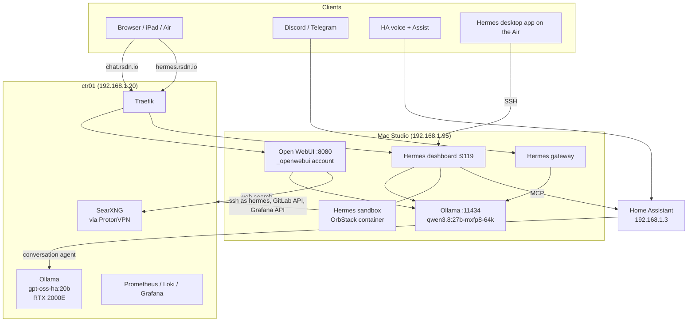

# Local AI

All inference in the homelab runs locally, on two machines with different jobs:

| Machine | Engine | Model(s) | Serves |
|---------|--------|----------|--------|
| **Mac Studio** (M5 Max, 64 GB) | Ollama 0.40 (native, MLX) | Qwen3.8 27B 8-bit default; Qwen3.8 4-bit and Qwen3.6 35B-A3B fallbacks | Hermes agent, Open WebUI |
| **ctr01** (RTX 2000E Ada, 16 GB) | Ollama 0.40 (Docker, CUDA) | `gpt-oss-ha:20b` | Home Assistant voice / Assist |

The split is deliberate. Home Assistant's voice model used to share the Studio with the Hermes model, and the two kept evicting each other (Ollama miscounts a llamacpp model loaded next to an MLX one). Moving HA's model to ctr01's otherwise idle GPU in October 2026 let the Studio keep one large 8-bit model resident. Jellyfin moved off the Studio for the same reason: the Studio's memory bandwidth is reserved for inference.

## Mac Studio

Everything always-on is a **system LaunchDaemon**, so it starts after an unattended reboot with nobody logged in (FileVault and auto-login are off on purpose). Config lives in [mac-config](https://gitlab.com/stetter-homelab/mac-config) under `setup/hosts/studio/` and is applied with `setup.sh`. See [Mac Studio](../infrastructure/mac-studio.md) for the daemon list.

### Ollama

- Runs the binary from the official `Ollama.app` cask, not the Homebrew formula: the formula lacks the xgrammar library, which breaks structured (JSON) output on MLX models.
- Models live on the internal disk (`~/.ollama/models`). `iogpu.wired_limit_mb` is raised to 7/8 of RAM (56 GiB) at every boot.
- `OLLAMA_KEEP_ALIVE=-1`, `OLLAMA_CONTEXT_LENGTH=16384`, `OLLAMA_HOST=0.0.0.0`. The `-64k` model tags carry their own 65536 context.
- **One large model at a time.** The 8-bit 27B uses 31-44 GB; any second large model goes over the wired limit and evicts it.

| Model | Type | Size | Role |
|-------|------|------|------|
| `qwen3.8:27b-mxfp8-64k` | Dense 27.8B, 8-bit MLX | 31 GB | Default for Hermes and Open WebUI (one shared copy) |
| `qwen3.8:27b-nvfp4-64k` | Dense 27.8B, 4-bit MLX | 18 GB | First fallback: ~2x faster generation |
| `qwen3.6:35b-a3b-nvfp4-64k` | MoE, ~3B active, 4-bit | 23 GB | Fast fallback for light work |
| `qwen3.6:35b-a3b-mxfp8-64k` | MoE, ~3B active, 8-bit | 38 GB | Comparison / benchmarks |
| `qwen3.5:9b` | Dense 9B GGUF | 6.6 GB | Utility, currently unused |

Benchmarks from 2026-10-28 (one model loaded, thinking off):

| Model | Generate (short) | Prefill (37k prompt) | Cold 37k prompt total |
|-------|------------------|----------------------|-----------------------|
| qwen3.6 35B-A3B 4-bit | 147 tok/s | 3,520 tok/s | 12 s |
| qwen3.8 27B 4-bit | 61 tok/s | 853 tok/s | 47 s |
| qwen3.8 27B 8-bit | 28 tok/s | 809 tok/s | 51 s |

The full model guide is `setup/hosts/studio/ollama/README.md` in mac-config.

### Open WebUI

- Native install (`uv tool install open-webui==0.12.4`), **not** Docker. Runs as the hidden non-admin role account `_openwebui` (UID 450) because Tools and Functions execute arbitrary Python; a deny ACL keeps that account out of `stetter`'s home.
- Data in `/var/openwebui/data`. Signup disabled.
- Binds `0.0.0.0:8080`, but a pf anchor admits only ctr01 (Traefik) and loopback. Reach it at **https://chat.rsdn.io**.
- Web search goes to SearXNG on ctr01 (`search.rsdn.io`), one concurrent request, 3 results, to stay inside the Brave API free tier.
- Upgrades go through `open-webui-upgrade.sh`, which backs up the data and rolls back on a failed health check.

### Hermes Agent

[Hermes](https://hermes-agent.nousresearch.com) (Nous Research) is a self-hosted agent that runs on the Studio's local model.

| Piece | Daemon | Notes |
|-------|--------|-------|
| Dashboard + backend | `com.hermes.dashboard` | Web UI at **https://hermes.rsdn.io** (port 9119, pf-restricted to Traefik like Open WebUI). The desktop app on the Air connects over SSH instead |
| Messaging gateway | `com.hermes.gateway` | Discord and Telegram bots, allowlisted users only |
| Sandbox | OrbStack container | Where the agent's shell commands run (`terminal.backend: docker`). Needs a console login after a reboot, since OrbStack is per-user |

What Hermes can reach, all with its own credentials, never John's:

- **Homelab hosts** (ctr01, dev01, sec01, nexus, pve-tc1) over SSH as the non-root user `hermes`, key restricted to the Studio's IP. Root only through three argument-checking sudo wrappers from vm-platform: `hermes-readlog` (read `/var/log`), `hermes-docker` (ctr01: ps, stats, logs, start/stop/restart, `compose-up`), `hermes-pve` (list/status/start/shutdown guests). No Synology access.
- **GitLab** as a group service account with Developer rights: branches and MRs, never protected `main`.
- **Logs and metrics** through a Grafana Viewer service account (Loki and Prometheus via Grafana's data-source proxy).
- **Home Assistant** through HA's built-in MCP server, limited to the entities exposed to Assist.
- **Google Workspace**, read-only scopes only.

The agent's config (`~/.hermes`) is tracked in a private whitelist git repo, not in mac-config.

### Observability

The Studio is scraped by Prometheus on ctr01 (`mac-studio-node` on :9100, `mac-studio-macmon` on :9101) plus textfile gauges for GPU unified memory and Ollama's loaded models. Grafana Alloy ships `/var/log/ollama.log` to Loki, filtered down to requests, loads, evictions and errors. Grafana has a Mac Studio dashboard and a "ctr01 — AI Load" dashboard, linked to each other.

## ctr01

The [ai stack](../stacks/ctr01.md#ai) holds what's left of AI on ctr01:

- **Ollama** with the whole RTX 2000E: `OLLAMA_KEEP_ALIVE=-1`, one loaded model, one parallel slot, 16k context, flash attention.
- **`gpt-oss-ha:20b`**: an alias over `gpt-oss:20b` (MoE, ~3.6B active, ~13 GB MXFP4) whose only change is defaulting to low reasoning. HA's "Think before responding" toggle otherwise runs gpt-oss at medium reasoning (3-39 s per command); the alias answers a tool call in about 1.5-2 s at ~45 tok/s, 100% on GPU.
- **SearXNG** behind its own gluetun/ProtonVPN sidecar, for Open WebUI's web search. Brave Search API plus Bing, Mojeek and Wikipedia.
- **ollama-metrics**: the same `ollama_*` gauges as the Studio, written for node-exporter.

Retired from ctr01 during 2026: the old Open WebUI container (moved native to the Studio), vLLM, Whishper, LibreTranslate and n8n.

## Home Assistant

- Conversation agent: the Ollama integration pointed at `http://ctr01:11434`, model `gpt-oss-ha:20b`, Think off, context 16384, keep alive -1.
- "Prefer handling commands locally" is on, so simple intents never touch the LLM.
- Speech-to-text and text-to-speech come from Home Assistant Cloud.
- Exposing fewer entities to Assist means a shorter prompt and a faster first word.

## Design Rules

- **Inference stays local.** No cloud LLM in the request path for Hermes, Open WebUI or HA voice.
- **One resident model per machine.** It avoids evictions and reload stalls.
- **Agents get their own least-privilege identities**, and widening them means adding a verb to a wrapper, not a broader sudoers rule.
- **Nothing on the Studio listens to the LAN unauthenticated**, except Ollama (:11434) and the metrics exporters.
