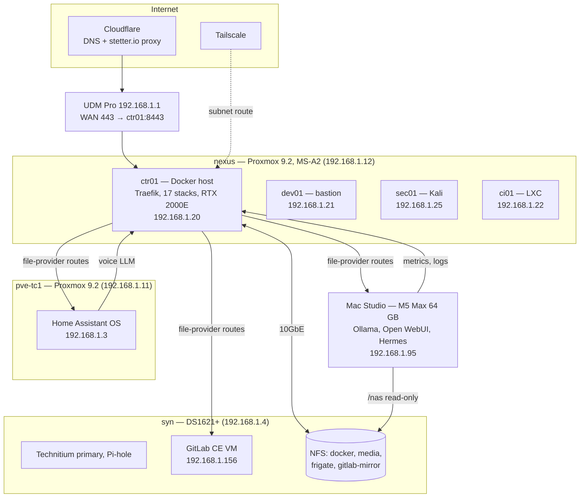

# Architecture Overview

The homelab is small on purpose: one hypervisor for containers, one Mac for AI, one box for Home Assistant, and a NAS underneath all of it.

## Design Principles

1. **Infrastructure as code.** VMs from OpenTofu + Ansible ([vm-platform](https://gitlab.com/stetter-homelab/vm-platform)), containers from one repo per Docker Compose stack ([compose-stacks](https://gitlab.com/stetter-homelab/compose-stacks)), Macs from [mac-config](https://gitlab.com/stetter-homelab/mac-config).
2. **CI deploys.** A merge to `main` in a stack repo runs Trivy, Gitleaks and `docker compose config`, then SSHes to ctr01 and brings the stack up. Renovate keeps images current.
3. **One front door.** Traefik on ctr01 terminates TLS for every `*.rsdn.io` name, and only routers that opt in to `websecure-public` are reachable from the internet.
4. **Local inference.** LLMs run on the Mac Studio and on ctr01's GPU, never in the cloud.
5. **Least privilege for agents.** Hermes and other automation get their own accounts and narrow wrappers.
6. **Stock defaults over custom config.** Every override has to earn its place.

## System Diagram

## Hosts and Roles

| Host | Runs | Page |
|------|------|------|
| nexus | ctr01, dev01, sec01, ci01 | [VM Overview](../infrastructure/vms/vm-overview.md) |
| ctr01 | Every Docker stack, Traefik, monitoring, HA's voice LLM | [ctr01 Stacks](../stacks/ctr01.md) |
| Mac Studio | Ollama (MLX), Open WebUI, Hermes | [Mac Studio](../infrastructure/mac-studio.md) |
| pve-tc1 | Home Assistant OS | [Hardware](hardware.md#pve-tc1-lenovo-thinkcentre-m720q) |
| syn | Storage, primary DNS, GitLab VM | [Synology](../stacks/synology.md) |

## Container Platform

All containers live on ctr01, one Git repo and one `/opt/stacks/<stack>` directory per stack:

| Group | Stacks |
|-------|--------|
| Platform | core (Traefik, Vault), authentik, monitoring, management, automation, technitium, standards |
| AI | ai (Ollama for HA, SearXNG) |
| Media | media (*arr, downloaders, Tdarr, Tunarr, ARM), mediaservers (Plex, Jellyfin, Emby), silo, tracearr, dispatcharr |
| Dev | devtools, gitlab-mirror, gitlab (disabled; GitLab moved to a VM), stetter-io |
| Disabled | frigate (VRAM given to Ollama) |

See [Stacks Overview](../stacks/index.md).

## Storage

| Tier | Where | Used for |
|------|-------|----------|
| ZFS `vm-storage` (4 TB NVMe) | nexus | VM disks |
| Local Docker volumes (`/var/lib/docker`, 411 GB LV) | ctr01 | Databases, app state, Ollama models |
| NFS over 10GbE | syn → ctr01 | Media library, bulk app data, Traefik certs, Vault, restic repo |
| Internal SSD | Studio | Ollama models, Open WebUI data, OrbStack |

Backups: Backrest (restic) snapshots ctr01's Docker volumes nightly into a repo on the NAS, `db-dumper` writes SQL dumps first, and nexus runs a weekly vzdump of its guests to the NAS. See [Backup & Restore](../runbooks/backup-restore.md).

## Identity and Secrets

- **Authentik** (`sso.rsdn.io`): forward auth for admin UIs (Traefik dashboard) and OIDC for Grafana, gated on the `Homelab Admins` group.
- **Vault** (`vault.rsdn.io`): file backend on NFS, Shamir unseal.
- **1Password**: the source of truth for every secret and SSH key. `.env` files on hosts are never committed.
- **SSH**: the same two keys on every Mac, split by purpose (`ssh-auth-key` for logins, `git-signing-key` for commit signing).

## Observability

Prometheus, Alertmanager (to Telegram), Loki, Promtail, Vector (syslog), Grafana, all on ctr01. See [Prometheus](../services/prometheus.md), [Grafana](../services/grafana.md), [Loki](../services/loki.md).

## Local AI

See [Local AI](ai.md).
