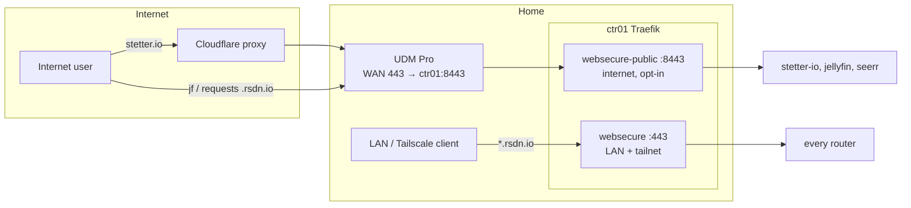

# Network Topology

How traffic gets in, around, and out of the Stetter Homelab.

## Segments

| Network | Subnet | Purpose |
|---------|--------|---------|
| Core LAN (VLAN 1) | 192.168.1.0/24 | Servers, VMs, Macs, clients |
| IoT (VLAN 10) | 192.168.3.0/24 | Smart plugs, sensors, hubs |
| Media (VLAN 2) | 192.168.4.0/24 | Reserved, unused |
| Storage | 10.0.10.0/24 | 10GbE DAC between nexus (`vmbr1`) and the Synology, MTU 9000 |
| Tailnet | 100.64.0.0/10 | Tailscale: remote access to the LAN via a subnet router |

!!! note "VLAN IDs vs subnets"
    VLAN IDs don't match the third octet (VLAN 10 is 192.168.3.x). Legacy, left as is.

Home Assistant (Core LAN) is allowed to initiate connections into the IoT VLAN; IoT devices can't initiate into the Core LAN.

## Address Allocation

Static reservations live below .100; DHCP hands out .100-.254.

| Host | IP | Role |
|------|----|------|
| rtr | 192.168.1.1 | UDM Pro gateway |
| switch | 192.168.1.2 | UniFi US-16-150W |
| ha | 192.168.1.3 | Home Assistant (VM on pve-tc1) |
| syn | 192.168.1.4 | Synology NAS, primary DNS |
| core | 192.168.1.5 | Former K8s sandbox (offline) |
| ap-u6 | 192.168.1.7 | UniFi U6+ |
| pve-tc1 | 192.168.1.11 | Proxmox (Home Assistant) |
| nexus | 192.168.1.12 | Proxmox (MS-A2) |
| bluefin | 192.168.1.13 | Linux desktop |
| ctr01 / rprx | 192.168.1.20 | Docker host, Traefik, secondary DNS |
| dev01 | 192.168.1.21 | Bastion |
| ci01 | 192.168.1.22 | CI runner LXC |
| sec01 | 192.168.1.25 | Kali |
| studio | 192.168.1.95 | Mac Studio |
| gitlab | 192.168.1.156 | GitLab CE VM on the Synology |
| air | 192.168.1.176 | MacBook Air |

Storage network: nexus 10.0.10.1, syn 10.0.10.4, ctr01 10.0.10.20, sec01 10.0.10.25.

## DNS

| Server | Host | Role |
|--------|------|------|
| Technitium | syn, 192.168.1.4 | Primary; authoritative for `rsdn.io`, ad blocking |
| Technitium | ctr01, 192.168.1.20 | Secondary |
| Pi-hole | syn | Legacy, set not to restart but still running (UI at `pihole.rsdn.io`) |

- Every web service is a CNAME to **`rprx.rsdn.io`** (ctr01, where Traefik listens), including the ones that actually live on the Studio, the GitLab VM or the Proxmox hosts. Traefik forwards those.
- Hosts themselves have A records (`studio`, `nexus`, `ha`, ...).
- Public DNS for `rsdn.io` and `stetter.io` is Cloudflare. Only the few internet-facing names exist there (see below).
- Tailscale clients get split DNS: `rsdn.io` → 192.168.1.4, so the same names work remotely.

## Reverse Proxy: Traefik

All HTTP(S) goes through one Traefik on ctr01. Traefik routes on the TLS SNI/`Host` header, not on DNS, so **which entrypoint a router listens on is what decides whether it's reachable from the internet.**



| Entrypoint | Port | Reachable from | Use |
|------------|------|----------------|-----|
| `web` | 80 | LAN | Permanent redirect to HTTPS |
| `websecure` | 443 | LAN, tailnet | Default for every router |
| `websecure-public` | 8443 | Internet (UDM Pro forwards WAN 443 here) | Opt-in per router |

**Routers on `websecure-public`** (as of 2026-10-30):

| Router | Host | Protection |
|--------|------|------------|
| `stetter-io` | `stetter.io`, `www.stetter.io` | Cloudflare-proxied; `ipAllowList` admits Cloudflare ranges only |
| `jellyfin`, `jellyfin-auth` | `jf.rsdn.io` | Jellyfin login; rate limit on the auth paths |
| `seerr` | `requests.rsdn.io` | Seerr login; rate limit |

Everything else stays on `websecure`. Never forward WAN traffic to ctr01:443.

**Certificates:** Let's Encrypt wildcard `rsdn.io` + `*.rsdn.io` via Cloudflare DNS-01, on both TLS entrypoints. No port 80 validation needed.

**Admin UIs** use the Authentik forward-auth middleware (`authentik@docker`). The Traefik dashboard is the first; it admits only the `Homelab Admins` group. An IP allowlist can't do this job: tailnet traffic arrives through the subnet router SNATed to a LAN address.

**Non-Docker backends** are routed from the file provider (`config/traefik/dynamic.yml` in compose-stacks/core):

| Host | Backend |
|------|---------|
| `chat.rsdn.io`, `ai.rsdn.io` | Open WebUI, `http://192.168.1.95:8080` (Studio) |
| `hermes.rsdn.io` | Hermes dashboard, `http://192.168.1.95:9119` (Studio) |
| `gitlab.rsdn.io` | GitLab VM, `https://192.168.1.156` |
| `home.rsdn.io` | Home Assistant, `http://192.168.1.3:8123` |
| `pve-nexus.rsdn.io`, `pve-hass.rsdn.io` | Proxmox UIs on :8006 |
| `synology.rsdn.io`, `unifi.rsdn.io` | DSM, UniFi |
| `technitium-syn.rsdn.io`, `technitium-ctr.rsdn.io` | Technitium UIs |
| `pihole.rsdn.io` | Pi-hole on the NAS |

The Studio's Open WebUI and Hermes ports are firewalled with pf so **only ctr01 (Traefik) and loopback** can reach them; going through `chat.rsdn.io` / `hermes.rsdn.io` is the only way in.

See [Traefik](../services/traefik.md) for labels and operations.

## Remote Access: Tailscale

| Node | Role |
|------|------|
| `ctr01-ts` | Host `tailscaled`, `tag:docker-host`, subnet router for `192.168.1.0/24` |
| `nexus-ts` | Subnet router for `192.168.1.0/24` |
| `studio-ts`, `air-ts`, `bluefin-tc1-ts`, `iphone`, `homeassistant` | Clients |
| `droplet-ts` | Cloud VM |

Remote clients reach every `*.rsdn.io` name through split DNS and the subnet route, landing on `websecure` like a LAN client. ctr01 runs `--accept-dns=false --accept-routes=false` so it never routes the LAN back through the tailnet.

Both ctr01 and nexus advertise `192.168.1.0/24`; Tailscale uses one at a time and fails over to the other. On 2026-10-30 ctr01 was the active one (`tailscale status --json` lists it under `PrimaryRoutes`).

## Inbound Firewall (UDM Pro)

| WAN port | Forwarded to | Purpose |
|----------|--------------|---------|
| 443/tcp | ctr01:8443 | Traefik `websecure-public` |

Other port forwards (for example Plex 32400) weren't re-checked in this pass.

## Outbound VPN

Two gluetun containers on ctr01 send traffic out through ProtonVPN WireGuard instead of the home IP: one for the media stack's downloaders and one for SearXNG (so search engines stop CAPTCHA-ing the home IP).

## Troubleshooting

```bash
dig @192.168.1.4 grafana.rsdn.io        # internal DNS: CNAME rprx → 192.168.1.20
dig @1.1.1.1 grafana.rsdn.io            # should be empty: not public
curl -I https://grafana.rsdn.io          # through Traefik
tailscale status                         # which node serves 192.168.1.0/24
```

- **404 from Traefik:** no router matches the Host, or the container isn't on `traefik_proxy`.
- **Works on the LAN, not from the internet:** the router isn't on `websecure-public` (usually correct).
- **chat/hermes 502:** the Studio daemon is down, or its pf anchor no longer lists ctr01's IP.
