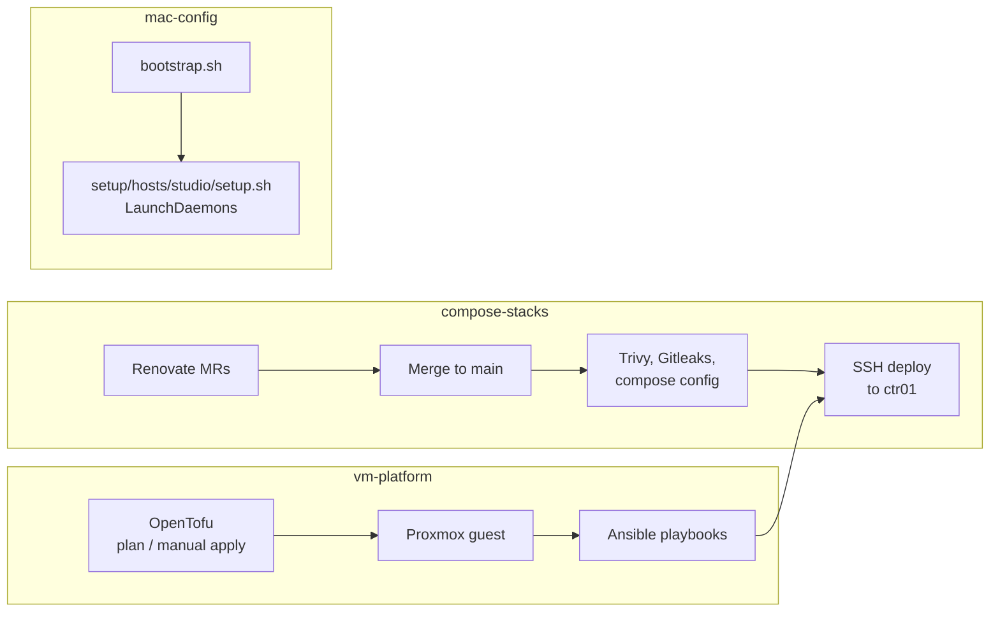

# Infrastructure Overview

Everything is defined in Git and applied by CI or by one idempotent script per layer.

| Layer | Repository | Tools | Applies to |
|-------|-----------|-------|-----------|
| VMs and Proxmox hosts | [vm-platform](https://gitlab.com/stetter-homelab/vm-platform) | OpenTofu (bpg/proxmox), Ansible | nexus, pve-tc1, ctr01, dev01, sec01, ci01 |
| Containers | [compose-stacks](https://gitlab.com/stetter-homelab/compose-stacks) (one repo per stack) | Docker Compose, GitLab CI, Renovate | ctr01 |
| CI templates | [ci-templates](https://gitlab.com/stetter-homelab/ci-templates) | GitLab CI | All stack repos |
| Macs | [mac-config](https://gitlab.com/stetter-homelab/mac-config) | Homebrew, GNU Stow, devbox, LaunchDaemons | Mac Studio, MacBook Air |
| Home Assistant | [home-assistant-config](https://gitlab.com/stetter-homelab/home-assistant-config) | HA YAML, CI | Home Assistant |
| Docs | [homelab-docs](https://gitlab.com/stetter-homelab/homelab-docs) | MkDocs Material | This site |

Archived: k8s-platform, talos-platform, talos-terraform-poc (their host, core.rsdn.io, is offline).

## Flow

## mac-config

One repo for both Macs: a shared Brewfile, Stow-managed dotfiles under `dotfiles/`, and a per-host layer under `setup/hosts/<LocalHostName>/` (only the Studio has one).

- **Apply:** `./setup/bootstrap.sh` on either Mac. It's idempotent, installs the host's Brewfile, and prints the `sudo setup/hosts/studio/setup.sh` command for the Studio's daemons.
- **Homebrew upgrades** run daily: a 10:00 LaunchAgent on the Air, a 04:00 LaunchDaemon on the Studio.
- See [Mac Studio](mac-studio.md).

## Pages

- [VM Platform](vm-platform.md)
- [VM Overview](vms/vm-overview.md)
- [Mac Studio](mac-studio.md)
- [Stacks](../stacks/index.md)
