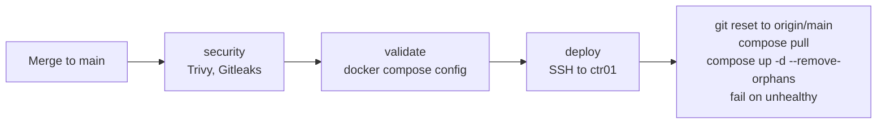

# ctr01 Stacks

Every Docker Compose stack on ctr01, as deployed on 2026-10-30. Each stack is its own repo under [compose-stacks](https://gitlab.com/stetter-homelab/compose-stacks), checked out at `/opt/stacks/<stack>`.

| Stack | Services | Hostnames |
|-------|----------|-----------|
| [core](#core) | traefik, vault, zork-root | traefik, vault, `rsdn.io` + file-provider routes |
| [authentik](#authentik) | authentik, worker, postgres, redis | sso |
| [monitoring](#monitoring) | prometheus, alertmanager, grafana, loki, promtail, vector, cadvisor, dcgm-exporter, pve-exporter, snmp-exporter, unpoller, docker-size-collector | grafana, prometheus, alertmanager, promtail |
| [management](#management) | portainer, portainer-agent, dozzle, semaphore (+mysql), pulse, backrest, db-dumper | portainer, dozzle, semaphore, pulse, backrest |
| [automation](#automation) | watchtower, gitlab-sync (gickup) | - |
| [ai](#ai) | ollama, ollama-metrics, searxng, gluetun-searxng | search |
| [media](#media) | gluetun, sonarr, radarr, lidarr, bazarr, prowlarr, sabnzbd, nzbget, seerr, tdarr, tunarr, arm | sonarr, radarr, lidarr, bazarr, prowlarr, sabnzbd, nzbget, requests, tdarr, tunarr, arm |
| [mediaservers](#mediaservers) | plex, jellyfin, emby, tautulli, uhf-server | plex, jf, emby, tautulli |
| [silo](#silo) | silo, postgres (pgvector), redis | silo, silo-jf |
| [tracearr](#tracearr) | tracearr, timescaledb, redis | tracearr |
| [dispatcharr](#dispatcharr) | dispatcharr, postgres | dispatcharr |
| [devtools](#devtools) | code-server, flame, it-tools, privatebin, gitlab-runner | code, flame, it-tools, privatebin |
| [gitlab-mirror](#gitlab-mirror) | gitlab-mirror | - |
| [technitium](#technitium-ctr01) | technitium | technitium-ctr (via core) |
| [stetter-io](#stetter-io) | web | stetter.io, www.stetter.io (public) |
| [frigate](#frigate) | frigate, postgres, redis | frigate (**disabled**) |
| [gitlab](#gitlab) | gitlab | **disabled**, moved to a VM |
| [standards](#standards) | - | Shared CLAUDE.md standards, not a running stack |

Hostnames are under `rsdn.io` unless shown otherwise.

## How Stacks Are Deployed

- Pipelines come from the shared, tag-pinned `stetter-homelab/ci-templates`.
- **Renovate** opens MRs for image updates; images are pinned by tag and digest.
- A stack with every service disabled (profile `disabled` or `deploy.replicas: 0`) uses the manual deploy job, because `compose up` exits with "no service selected" otherwise.
- `/opt/stacks/CLAUDE.md` is a symlink to `standards/CLAUDE-GLOBAL.md`, so every Claude Code session on ctr01 loads the shared rules. See [standards](#standards).
- Day-to-day work happens on ctr01 itself (VS Code Remote-SSH); ctr01 is also the dev workspace.

Shared Docker networks: `traefik_proxy` (ingress) and `monitoring_external` (scrape targets).

## core

Traefik v3.7 and Vault 2.2. See [Traefik](../services/traefik.md) and [Vault](../services/vault.md).

- Ports 80, 443 (`websecure`) and 8443 (`websecure-public`).
- `config/traefik/` is mounted as a **directory**, so `dynamic.yml` edits hot-reload after a deploy (a single-file mount would pin the old inode).
- Certs in `/mnt/synology/docker/core/traefik/acme.json`.
- `zork-root` answers the bare `rsdn.io` host with a one-line nginx page.
- Tailscale isn't in this stack any more: it runs as host `tailscaled` on ctr01.

## authentik

[Authentik](../services/authentik.md) 2026.5 at `sso.rsdn.io`. It provides the `authentik@docker` forward-auth middleware and OIDC for Grafana. Providers, applications and the `Homelab Admins` group are defined as blueprints in the repo, not in the UI.

## monitoring

| Service | Role |
|---------|------|
| Prometheus 3.15 | Scrapes ctr01, nexus, pve-tc1, Synology, Home Assistant, the Studio, GitLab VM, Traefik, cAdvisor, DCGM |
| Alertmanager | Routes alerts to Telegram |
| Grafana 13 | Dashboards; OIDC login via Authentik |
| Loki 3.7 + Promtail | Container logs; the Studio's Alloy pushes to `ctr01:3100` |
| Vector | Syslog receiver on 5514/udp, forwards to Loki |
| pve-exporter, snmp-exporter, unpoller, dcgm-exporter | Proxmox, Synology, UniFi, GPU |
| docker-size-collector | Docker directory and volume sizes |

Alert rules: disk, GPU, volume. After a deploy that changes `prometheus.yml`, run `docker compose restart prometheus`: the file is a single-file bind mount, so a SIGHUP reloads the stale copy.

## management

| Service | Role |
|---------|------|
| Portainer EE 3.0 + agent | Docker UI |
| Dozzle | Live container logs |
| Semaphore + MySQL | Ansible UI |
| Pulse | Proxmox and Docker monitor |
| Backrest | Restic backups of ctr01's Docker volumes to `/mnt/synology/docker/backups/restic-repo` |
| db-dumper | SQL dumps of live databases at 01:30, picked up by Backrest |

## automation

- **Watchtower**: automatic container image updates.
- **gitlab-sync** (gickup): nightly flat-file backup of every GitLab.com repo to the NAS.

## ai

Home Assistant's voice LLM and Open WebUI's web search. See [Local AI](../architecture/ai.md), [Ollama](../services/ollama.md), [SearXNG](../services/searxng.md).

| Service | Port | Notes |
|---------|------|-------|
| ollama | 11434 | `gpt-oss-ha:20b`, whole RTX 2000E, keep-alive forever |
| ollama-metrics | - | `/api/ps` → node-exporter textfile |
| searxng | via gluetun | `search.rsdn.io` |
| gluetun-searxng | 8081 | ProtonVPN egress for SearXNG |

Removed in 2026: Open WebUI (now on the Studio), vLLM, Whishper, LibreTranslate, n8n. Their volumes and NFS data were kept.

## media

All of sabnzbd, nzbget, sonarr, radarr, lidarr, bazarr, prowlarr and seerr share `gluetun`'s network namespace, so their traffic leaves through ProtonVPN. Tdarr, Tunarr and ARM use the GPU. ARM rips CDs and DVDs from a Dell DW316 drive attached to ctr01.

`seerr` (`requests.rsdn.io`) is on the public entrypoint with a rate limit.

## mediaservers

| Service | Notes |
|---------|-------|
| Plex | Primary media server, NVENC |
| Jellyfin | `jf.rsdn.io`, public entrypoint; back on ctr01 since 2026-10-27 after a stint on the Studio |
| Emby | Secondary |
| Tautulli | Plex statistics |
| uhf-server | IPTV DVR backend, `ctr01:8001` |

The project path is `compose-stacks/mediaservers` (renamed from `media-servers`). The stack runs with an extra compose file, so `hermes-docker compose-up` refuses it.

## silo

[Silo](https://github.com/Silo-Server/silo-server), a pre-release media server with Jellyfin/Emby-compatible APIs, under evaluation next to the mediaservers stack. Web UI on `silo.rsdn.io` (8095), Jellyfin API on `silo-jf.rsdn.io` (8097) for Infuse and similar clients.

## tracearr

[Tracearr](https://github.com/connorgallopo/tracearr): watch history and analytics for the media servers, on TimescaleDB.

## dispatcharr

IPTV stream manager with HDHomeRun emulation for the media servers, GPU transcoding. `dispatcharr.rsdn.io`.

## devtools

code-server, Flame (start page built from `flame.*` Docker labels), IT-Tools, PrivateBin, and a containerized GitLab Runner. ctr01 also runs `gitlab-runner` as a host systemd service.

## gitlab-mirror

Mirrors every GitLab.com group and project John owns or maintains into the self-hosted GitLab at `gitlab.rsdn.io` on a schedule.

## technitium (ctr01)

Secondary Technitium DNS on 192.168.1.20:53; UI at `technitium-ctr.rsdn.io`. The primary runs on the Synology.

## stetter-io

The public site **stetter.io**: a static Astro site built into an nginx image by CI. Cloudflare proxies it; the Traefik router is only on `websecure-public` and only accepts Cloudflare IPs. No cookies, analytics or third-party requests.

## frigate

Frigate 0.17 (TensorRT) with Postgres and Redis. **Disabled** since 2026-10-28 (`deploy.replicas: 0`) to free VRAM for Home Assistant's LLM and cut fan noise. Recordings stay on `/volume1/frigate`.

## gitlab

GitLab CE moved off ctr01 to a VM on the Synology (192.168.1.156). The compose service is behind the `disabled` profile; `gitlab.rsdn.io` is now a file-provider route in core.

## standards

Shared standards for every stack (`CLAUDE-GLOBAL.md`, `CLAUDE-TEMPLATE.md`, `STORAGE.md`). A `sync` job fast-forwards `/opt/stacks/standards` on each merge.

## Storage Conventions

| Kind | Where |
|------|-------|
| Databases, app state | Local named volumes under `/var/lib/docker` (411 GB LV) |
| Bulk data, certs, media | NFS: `/mnt/synology/{docker,media,frigate,gitlab-mirror}` over 10GbE |
| Config | Git-tracked in the stack repo, bind-mounted read-only |

Containers run as UID 1027 (`stetter`), which matches the Synology. Primary GIDs differ between the hosts (1027 on ctr01, 100 on the NAS), so mixed GIDs on NFS are normal; the owner UID is what matters.
