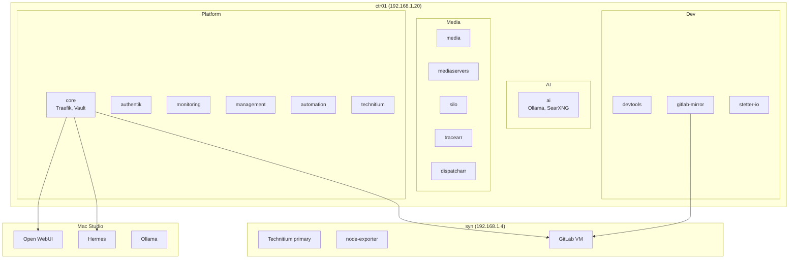

# Stacks Overview

Containers run in three places:

| Where | How | What |
|-------|-----|------|
| **ctr01** | Docker Compose, one repo per stack under [compose-stacks](https://gitlab.com/stetter-homelab/compose-stacks), CI-deployed to `/opt/stacks/<stack>` | Almost everything: 17 stacks |
| **syn** | Synology Container Manager, `/volume1/docker/stacks/` | Primary DNS, node-exporter |
| **Mac Studio** | OrbStack | Only the Hermes sandbox container; Ollama, Open WebUI and Hermes themselves are native LaunchDaemons |



## Stack Pages

- [ctr01 Stacks](ctr01.md): every stack, what's in it, and how CI deploys it
- [Synology Stacks](synology.md): DNS and the GitLab VM
- [Renovate](renovate.md): automated image updates
- [Mac Studio](../infrastructure/mac-studio.md): the native AI services

## Conventions

Every stack repo follows the shared [standards](ctr01.md#standards):

```
<stack>/
├── compose.yml        # images pinned by tag + digest (Renovate)
├── .env.example       # template; .env stays on the host
├── config/            # git-tracked config, bind-mounted read-only
├── README.md
├── CLAUDE.md          # stack notes, points at ../standards
├── renovate.json
└── .gitlab-ci.yml     # security → validate → deploy
```

- Join `traefik_proxy` and add Traefik labels for a web UI; default to the `websecure` entrypoint. See [Traefik](../services/traefik.md).
- Add `flame.*` labels so the service shows up on [Flame](../services/flame.md).
- Run as `PUID=1027`.
- Disable a stack with `deploy.replicas: 0` (profiles can't disable a whole stack) and switch its deploy job to manual.

See [Adding New Stacks](../runbooks/new-stack.md).
